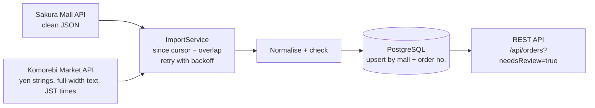

# ec-order-hub

[](https://github.com/yahayuta/ec-order-hub/actions/workflows/ci.yml)

A Spring Boot service that imports orders from several marketplaces into one PostgreSQL schema,
the way a multi-channel online shop needs them: incrementally, without duplicates, surviving
marketplace outages, and with every order that does not add up set aside for a person.

The marketplaces ("Sakura Mall" and "Komorebi Market") and all their data are invented. Both are
served by the app itself under `/mock`, so everything runs locally with one command.

**Stack:** Java 21 · Spring Boot 3.5 · PostgreSQL 16 · Flyway · Docker · Terraform (AWS ECS Fargate + RDS) · GitHub Actions

## What it does



| Concern | How it is handled |
|---|---|
| Different formats | One adapter per marketplace maps into a shared `Order`. Komorebi's `"２，４００円"`, `"ＭＵＧ－ＲＥＤ－０１"` and offset-less Japan times are normalised (NFKC, yen parsing, `Asia/Tokyo`). |
| Only new and changed orders | A cursor per marketplace stores the latest update time seen. Each run asks from the cursor minus a 5-minute overlap, so updates that arrive late are not missed. |
| No duplicates | `(mall, external_id)` is unique. One `INSERT … ON CONFLICT DO UPDATE … WHERE content_hash <> …` stores new orders, updates changed ones and skips identical ones, and reports which of the three happened. Re-running an import is harmless. |
| Marketplace outages | Timeouts, 5xx and 429 are retried with exponential backoff; 4xx fail at once. If every attempt fails, the run is recorded as `FAILED` and the cursor stays, so the next run fetches the same orders. |
| Orders that look wrong | Lines that do not add up to the total, non-positive quantities, unreadable amounts and unknown states are stored with `needs_review` and a readable reason, never dropped. |
| Visibility | Every run is a row in `import_runs` (fetched / inserted / updated / unchanged / flagged / attempts / error). |

## Run it

```bash
docker compose up --build            # PostgreSQL + the app, imports every 5 minutes

curl -X POST localhost:8080/api/imports/sakura
curl -X POST localhost:8080/api/imports/komorebi
curl 'localhost:8080/api/orders?needsReview=true'
curl localhost:8080/api/imports
```

Try the failure paths against the mock marketplaces:

```bash
curl -X POST localhost:8080/mock/sakura/orders/SK-240002/cancel     # customer cancels
curl -X POST localhost:8080/api/imports/sakura                      # -> "updated": 1

curl -X POST 'localhost:8080/mock/komorebi/faults?count=2'          # two 503s in a row
curl -X POST localhost:8080/api/imports/komorebi                    # -> "attempts": 3, SUCCEEDED
```

With the sample data, Komorebi's `KM-0002` is flagged (`lines add up to 4,400 but the order says
5,000`) and `KM-0003` is flagged (`unknown state "on_hold"`); everything else flows through.

## API

| Method and path | Purpose |
|---|---|
| `GET /api/orders?mall=&status=&needsReview=&limit=` | Search orders; `needsReview=true` is the review queue |
| `GET /api/orders/{id}` | One order with its lines |
| `POST /api/imports/{mall}` | Run an import now and return its result |
| `GET /api/imports` | Recent import runs |
| `GET /actuator/health` | Health check for the load balancer |

## Tests

```bash
mvn verify                                   # unit tests only
docker compose up -d db
SPRING_DATASOURCE_URL=jdbc:postgresql://localhost:5432/orderhub mvn verify   # plus the integration test
```

- **Unit tests** cover normalisation (full-width digits, yen strings, Japan time), both
  marketplace mappings, the review checks, the content hash and the retry policy.
- **The integration test** runs the real HTTP clients and SQL against PostgreSQL, with the mock
  marketplaces behind a JDK HTTP server. In order: first import stores everything, a second
  import changes nothing, a cancellation updates one order, messy data is normalised and
  flagged, a brief outage is retried, a long outage is recorded without moving the cursor, and
  the review queue is served over HTTP.

CI runs both (PostgreSQL as a service container), builds the Docker image and validates the
Terraform.

## AWS (`infra/aws`)

Terraform for ECS Fargate behind an ALB, RDS PostgreSQL in private subnets, ECR and CloudWatch
Logs. The database password is created and stored by RDS in Secrets Manager
(`manage_master_user_password`) and injected into the task as a secret; it never appears in
variables or state.

It is a reference configuration: CI runs `terraform fmt -check` and `terraform validate`, but it
has not been applied. Notes on the choices:

- Tasks run in public subnets with a public IP instead of behind a NAT gateway, to keep a demo
  environment cheap; only the ALB can reach them.
- One task, because two schedulers would import the same marketplace at once. Scaling out would
  first need a lock (for example a PostgreSQL advisory lock) around each import.

## Layout

```
src/main/java/.../domain     Order, normalisation and review checks (no framework code)
src/main/java/.../mall       one client per marketplace, retry policy, settings
src/main/java/.../importer   import flow, repositories (JdbcClient + SQL)
src/main/java/.../api        REST API
src/main/java/.../mock       the fictional marketplaces (profile "mock")
src/main/resources           Flyway migration, sample marketplace data
infra/aws                    Terraform
```

## License

MIT
